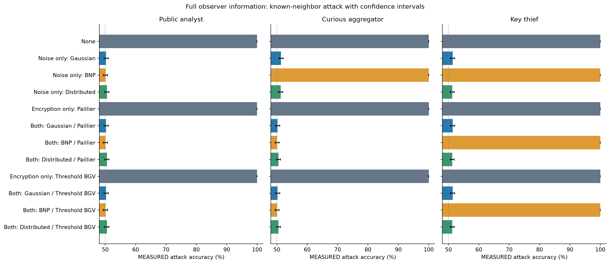
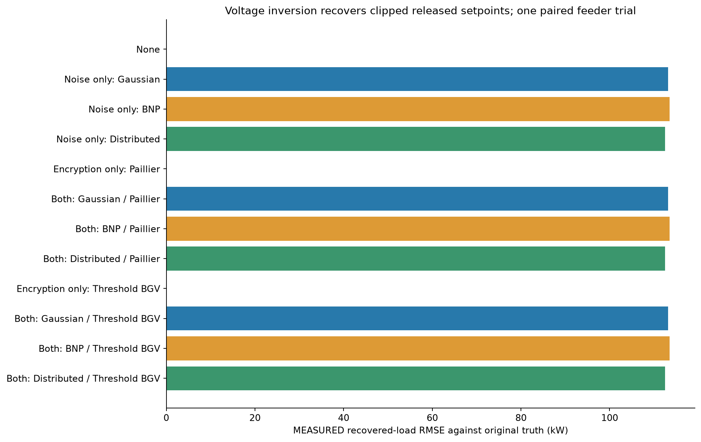
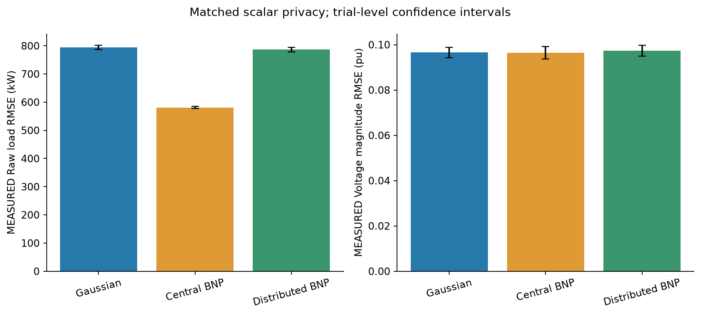
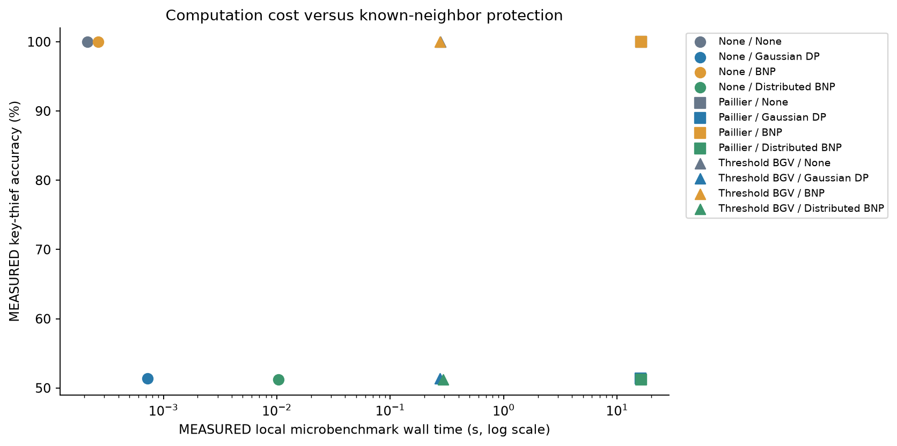

# Encryption and noise: direct-load threat-model results

M = MEASURED in this session; R = RECORDED from the historical results; A = ANALYTIC from the stated formula; P = PREDICTED by the task prompt. Brackets in accuracy and utility tables are MEASURED confidence intervals at the predeclared 95% confidence level.

Noise added at each meter survives key theft. A central noise service does not protect the unperturbed individual messages that the compromised key can decrypt. Encryption alone leaves exact public aggregates exposed.

## Scope and evidence

MEASURED workload: 91 load elements, 10 meters per element, 6 times, 30 utility trials. ANALYTIC calibration: epsilon=0, delta=0.01, sensitivity=20 kW, one meter reading at one time. Public clipping is [0,200] kW. This is a synthetic IEEE 123-bus test feeder, not field customer data.

The experiment publishes raw noisy sums for each load element and complex retained-node phasors calculated from clipped sums. The code calls these bus sums, but a physical bus can host multiple load-element rows. A separate clipped-sum channel is also evaluated. A public analyst sees the release and public network. A curious aggregator additionally sees transit messages but has no key. A key thief sees the same messages and owns the Paillier key or a committed BGV quorum. Noise seeds and honest meter random draws are evaluator-only information.

The two known neighboring datasets differ only in the target reading. Other target-row meters are fixed at ANALYTIC 10 kW each; the target is ANALYTIC 0 or 20 kW. Guessing this binary world is not recovering an arbitrary customer reading from a bus sum. Full-view bus and meter classification share the same hypothesis; channel-restricted attacks are reported separately.

MEASURED: 20000 independent noise trials per attack cell, paired across backend/observer cells. Real cryptography is demonstrated separately on each backend/mechanism. The voltage-only experiment performs MEASURED 80000 actual AC solves, with MEASURED 0 failures.

## Utility and protection cost

Utility columns are MEASURED plaintext-equivalent mechanism averages. Encrypted differences are checked below. Runtime is the separately matched microbenchmark, with MEASURED 3 repetitions, ANALYTIC workload of ten meters by ninety-six values plus one service slot. It includes fresh key setup for both encryption backends. Message estimates omit setup traffic and are not network measurements. Zero service messages keep the contributor count matched outside central BNP.

| Case | Raw RMSE kW | Voltage RMSE pu | Clipped | Micro time s, mean +/- SD | Message MiB | Public accuracy | Aggregator accuracy | Key-thief accuracy |
|---|---:|---:|---:|---:|---:|---|---|---|
| None | M 0 | M 0 | M 0.000% | M 0.0002142 +/- 0.000116 | A 0.0080566 | M 100.000% [99.981%, 100.000%] | M 100.000% [99.981%, 100.000%] | M 100.000% [99.981%, 100.000%] |
| Noise only: Gaussian DP | M 794.28 | M 0.096538 | M 89.890% | M 0.00072347 +/- 6.86e-05 | A 0.0080566 | M 50.275% [49.582%, 50.968%] | M 51.385% [50.692%, 52.077%] | M 51.385% [50.692%, 52.077%] |
| Noise only: BNP | M 580.67 | M 0.096396 | M 90.330% | M 0.0002668 +/- 2.48e-05 | A 0.0080566 | M 50.085% [49.392%, 50.778%] | M 100.000% [99.981%, 100.000%] | M 100.000% [99.981%, 100.000%] |
| Noise only: Distributed BNP | M 786.37 | M 0.097364 | M 90.195% | M 0.010321 +/- 0.000472 | A 0.0080566 | M 50.540% [49.847%, 51.233%] | M 51.255% [50.562%, 51.947%] | M 51.255% [50.562%, 51.947%] |
| Encryption only: Paillier | M 0 | M 0 | M 0.000% | M 16.32 +/- 0.15 | A 0.51562 | M 100.000% [99.981%, 100.000%] | M 100.000% [99.981%, 100.000%] | M 100.000% [99.981%, 100.000%] |
| Both: Gaussian DP / Paillier | M 794.28 | M 0.096538 | M 89.890% | M 16.18 +/- 0.211 | A 0.51562 | M 50.275% [49.582%, 50.968%] | M 50.275% [49.582%, 50.968%] | M 51.385% [50.692%, 52.077%] |
| Both: BNP / Paillier | M 580.67 | M 0.096396 | M 90.330% | M 16.295 +/- 0.251 | A 0.51562 | M 50.085% [49.392%, 50.778%] | M 50.085% [49.392%, 50.778%] | M 100.000% [99.981%, 100.000%] |
| Both: Distributed BNP / Paillier | M 786.37 | M 0.097364 | M 90.195% | M 16.2 +/- 0.144 | A 0.51562 | M 50.540% [49.847%, 51.233%] | M 50.540% [49.847%, 51.233%] | M 51.255% [50.562%, 51.947%] |
| Encryption only: Threshold BGV | M 0 | M 0 | M 0.000% | M 0.27543 +/- 0.00699 | M 6.2536 | M 100.000% [99.981%, 100.000%] | M 100.000% [99.981%, 100.000%] | M 100.000% [99.981%, 100.000%] |
| Both: Gaussian DP / Threshold BGV | M 794.28 | M 0.096538 | M 89.890% | M 0.27529 +/- 0.00351 | M 6.2536 | M 50.275% [49.582%, 50.968%] | M 50.275% [49.582%, 50.968%] | M 51.385% [50.692%, 52.077%] |
| Both: BNP / Threshold BGV | M 580.67 | M 0.096396 | M 90.330% | M 0.27526 +/- 0.00253 | M 6.2536 | M 50.085% [49.392%, 50.778%] | M 50.085% [49.392%, 50.778%] | M 100.000% [99.981%, 100.000%] |
| Both: Distributed BNP / Threshold BGV | M 786.37 | M 0.097364 | M 90.195% | M 0.29371 +/- 0.00778 | M 6.2536 | M 50.540% [49.847%, 51.233%] | M 50.540% [49.847%, 51.233%] | M 51.255% [50.562%, 51.947%] |

The no-encryption microtimings include local noise preparation and array summation. End-to-end voltage computation and networking are excluded for every microbenchmark arm. Numerical attack cells do not certify ciphertext security or finite-precision DP.

## Paired distributed-BNP utility differences

| Difference | Raw RMSE kW | Clipped RMSE kW | Clipping fraction | Voltage RMSE pu |
|---|---|---|---|---|
| Distributed BNP minus Gaussian DP | M -7.90166 [-18.6651, 2.8618] | M 0.0863139 [-1.07665, 1.24928] | M 0.0030525 [-0.00163546, 0.00774047] | M 0.000825798 [-0.0019909, 0.00364249] |
| Distributed BNP minus BNP | M 205.702 [195.147, 216.257] | M -0.428603 [-1.6547, 0.797495] | M -0.0013431 [-0.00663423, 0.00394802] | M 0.000968246 [-0.00311613, 0.00505263] |

Distributed BNP has substantially more raw error than central BNP. Its raw and voltage differences from Gaussian include zero in these paired intervals. Heavy clipping dominates this operating point; the result does not establish a useful deployment budget.

## Voltage inversion and prediction audit

The naive identity yields actual nodal power, not nominal load-element setpoints. The implementation uses the full named, unmerged network with loads disabled in Y; capacitors, transformers and finite source impedance remain. Public Norton source currents supply the offset. All omitted nodes, including source terminals, are eliminated. The attacker receives only retained phasors and public model metadata, never solved private slack voltages.

ANALYTIC units: V_volts=V_pu*Vbase; I_load=J_source-Y_network*V_volts; S_load_kVA=V_volts*conj(I_load)/1000. A public branch-current map handles wye/delta connections, power factor, voltage breakpoints and constant-power/current/impedance load laws. Real and reactive equations jointly identify nominal active-power setpoints. Capacitor power is not subtracted a second time.

MEASURED baseline nominal-setpoint residual: RMS 0.0013187007 kW, maximum 0.0112580602 kW. MEASURED nodal power residual maximum 0.00722782191 kVA. MEASURED matrix rank 91. Solver voltage-iteration tolerance is MEASURED 0.0001 pu; the predeclared engineering power gate is ANALYTIC 0.1 kW/kVA. This normalized gate is not a theorem converting solver tolerance into power error.

MEASURED actual terminal power differs from nominal inputs by up to 5.09149 kW. Thus the literal exact-setpoint interpretation of V*conj(YV) is false; model-aware reconstruction works within the reported residuals. Recovered loads follow clipped noisy setpoints, not the raw noise before clipping.

| Mechanism | PREDICTED voltage-only accuracy | MEASURED accuracy and confidence interval | ANALYTIC ideal classifier |
|---|---:|---|---:|
| None | P 100.000% | M 100.000% [99.981%, 100.000%] | A 100.000% |
| Gaussian DP | P 50.500% | M 50.345% [49.652%, 51.038%] | A 50.500% |
| BNP | P 50.500% | M 50.705% [50.012%, 51.398%] | A 50.500% |
| Distributed BNP | P 50.500% | M 50.680% [49.987%, 51.373%] | A 50.500% |

The analytic value is for exact recovery of the clipped release in this selected midpoint test. It is not a claim that every voltage post-processing preserves total variation. Measured inversion error and quantization can alter decisions. The AC statistical trials use plaintext-equivalent releases; actual encrypted feeder releases are independently inverted in the case table below.

| Case | Recovered vs true load RMSE kW | Recovered vs clipped release RMSE kW |
|---|---:|---:|
| None | M 0.001318701 | M 0.001318701 |
| Noise only: Gaussian DP | M 113.1884 | M 0.004532009 |
| Noise only: BNP | M 113.5414 | M 0.00303125 |
| Noise only: Distributed BNP | M 112.4647 | M 0.005820024 |
| Encryption only: Paillier | M 0.001318701 | M 0.001318701 |
| Both: Gaussian DP / Paillier | M 113.1884 | M 0.004532009 |
| Both: BNP / Paillier | M 113.5414 | M 0.00303125 |
| Both: Distributed BNP / Paillier | M 112.4647 | M 0.005820024 |
| Encryption only: Threshold BGV | M 0.001630257 | M 0.001318763 |
| Both: Gaussian DP / Threshold BGV | M 113.1883 | M 0.004531989 |
| Both: BNP / Threshold BGV | M 113.5414 | M 0.003031247 |
| Both: Distributed BNP / Threshold BGV | M 112.4647 | M 0.005820009 |

## All task-prompt quantitative predictions

| Quantity | PREDICTED | ANALYTIC | MEASURED |
|---|---:|---:|---:|
| Key-thief accuracy, None (same observation law with or without encryption) | P 100.000% | A 100.000% | M 100.000% [99.981%, 100.000%] |
| Key-thief accuracy, Gaussian DP (same observation law with or without encryption) | P 51.600% | A 51.581% | M 51.385% [50.692%, 52.077%] |
| Key-thief accuracy, BNP (same observation law with or without encryption) | P 100.000% | A 100.000% | M 100.000% [99.981%, 100.000%] |
| Key-thief accuracy, Distributed BNP (same observation law with or without encryption) | P 51.200% | A 51.162% | M 51.255% [50.562%, 51.947%] |
| Public raw-sum accuracy, None | P 100.000% | A 100.000% | M 100.000% [99.981%, 100.000%] |
| Encrypted curious-aggregator accuracy, None | P 50.000% | A 100.000% | M 100.000% [99.981%, 100.000%] |
| Public raw-sum accuracy, Gaussian DP | P 50.500% | A 50.500% | M 50.275% [49.582%, 50.968%] |
| Encrypted curious-aggregator accuracy, Gaussian DP | P 50.000% | A 50.500% | M 50.275% [49.582%, 50.968%] |
| Public raw-sum accuracy, BNP | P 50.500% | A 50.500% | M 50.085% [49.392%, 50.778%] |
| Encrypted curious-aggregator accuracy, BNP | P 50.000% | A 50.500% | M 50.085% [49.392%, 50.778%] |
| Public raw-sum accuracy, Distributed BNP | P 50.500% | A 50.500% | M 50.540% [49.847%, 51.233%] |
| Encrypted curious-aggregator accuracy, Distributed BNP | P 50.000% | A 50.500% | M 50.540% [49.847%, 51.233%] |
| Distributed share half-width, kW | P 430.4 | A 430.406835529 | M largest sampled absolute share 430.406811; not an estimate of the hard bound |
| Distributed aggregate hard bound, kW | P 4304 | A 4304.068355291 | M largest sampled absolute sum 3925.057941; finite sampling cannot prove the bound |
| Distributed aggregate RMS noise, kW | P about 786 | A 785.811776 | M 785.985626 from independent sums; M 786.373632 feeder RMSE |
| Distributed per-meter effective delta | P 0.0232 | A 0.023233832 | M local attack accuracy above; not a direct TV estimate |
| Central BNP aggregate RMS, kW | P about 577 | A 577.350269 | M 580.671784 feeder RMSE |
| Gaussian aggregate RMS, kW | P about 798 | A 797.863672 | M 794.275289 feeder RMSE |

The key-thief accuracy predictions agree with the analytic formulas at their stated rounding and lie inside the measured intervals. The curious-aggregator chance prediction is structurally wrong: it also sees the public release. Exact sums identify the known neighbor. Noisy aggregate accuracy is ANALYTIC 50.5%, not exactly chance, though these sample sizes do not reliably separate such a small advantage.

MEASURED distributed aggregate TV estimate 0.010020, interval [0.009825713236696697, 0.010217132691885447], from MEASURED 1000000 independent sums; ANALYTIC target 0.01. All sampled shares and sums respected their analytic bounds. The exact-CDF calibration and bounds are in distributed_verification.json.

## Do the costs compound?

Paired error criteria use absolute differences in raw-load RMSE and voltage-magnitude RMSE on the same prepared draw. The predeclared acceptance settings are 0.003 kW and 1.5e-6 pu, chosen from the task prompt, rather than calculated privacy bounds. Maximum elementwise deviations are separate, stricter diagnostics.

| Backend / mechanism | Paired raw RMSE difference kW | Paired voltage RMSE difference pu | Paired utility result | Maximum load / voltage diagnostic |
|---|---:|---:|---|---|
| Paillier / None | M 8.59482677e-10 | M 4.21727352e-13 | PASS | PASS / PASS |
| Threshold BGV / None | M 0.000923081257 | M 5.52270452e-07 | PASS | PASS / FAIL |
| Paillier / Gaussian DP | M -1.14823706e-11 | M -8.16013923e-15 | PASS | PASS / PASS |
| Threshold BGV / Gaussian DP | M -1.38763588e-05 | M 8.30085198e-09 | PASS | PASS / PASS |
| Paillier / BNP | M -1.53477231e-11 | M -1.29063427e-15 | PASS | PASS / PASS |
| Threshold BGV / BNP | M 3.88621091e-05 | M -1.03414495e-08 | PASS | PASS / PASS |
| Paillier / Distributed BNP | M -2.00088834e-11 | M 1.17128529e-14 | PASS | PASS / PASS |
| Threshold BGV / Distributed BNP | M 5.72088379e-06 | M -5.26643526e-09 | PASS | FAIL / PASS |

The distributed-BNP BGV maximum elementwise load error exceeds the strict empirical cutoff but remains below the ANALYTIC fixed-point sum bound of 0.0055 kW. The historical encryption-only BGV maximum voltage error also slightly exceeds the rounded cutoff. Neither diagnostic alone establishes an increase in paired utility RMSE. The paired noisy-arm results above support negligible added error on the tested encrypted draw, not universal equivalence.

Time uses a predeclared practical equivalence setting of +/-10% and MEASURED paired intervals. The margin is a chosen test setting, not a calculated privacy bound. A pass requires the entire interval inside that margin. Failure requires the entire interval outside it; other outcomes are inconclusive. Exact equality cannot be established by a finite timing sample.

| Backend / mechanism vs no noise | Mean time difference s | Relative difference interval | Within combined run SD? | Result |
|---|---:|---|---|---|
| Paillier / Gaussian DP | M -0.13979 | M [-3.448%, 1.737%] | Yes | PASS |
| Paillier / BNP | M -0.0250037 | M [-1.894%, 1.581%] | Yes | PASS |
| Paillier / Distributed BNP | M -0.11962 | M [-3.069%, 1.610%] | Yes | PASS |
| Threshold BGV / Gaussian DP | M -0.000141433 | M [-9.330%, 9.355%] | Yes | PASS |
| Threshold BGV / BNP | M -0.000168367 | M [-8.375%, 8.366%] | Yes | PASS |
| Threshold BGV / Distributed BNP | M 0.0182778 | M [-2.106%, 15.451%] | No | INCONCLUSIVE |

These are local serialized workloads with fixed payload counts, no authenticated network, and different cryptographic parameters. They do not establish security-equivalent throughput or production latency.

## Historical full-feeder cost context

| Backend / mechanism | Wall time s | Ciphertext MiB | Decryption-share MiB |
|---|---:|---:|---:|
| Paillier / None | R 97.873 | A 2.933 | Not applicable |
| Paillier / Gaussian DP | R 92.496 | A 2.933 | Not applicable |
| Paillier / BNP | R 95.594 | A 2.933 | Not applicable |
| Paillier / Distributed BNP | M 96.235 | A 2.933 | Not applicable |
| Threshold BGV / None | R 21.94 | R 500.819 | R 68.256 |
| Threshold BGV / Gaussian DP | R 21.921 | R 500.819 | R 68.256 |
| Threshold BGV / BNP | R 21.683 | R 500.819 | R 68.256 |
| Threshold BGV / Distributed BNP | M 27.903 | M 500.819 | M 68.256 |

Historical Paillier setup is excluded while BGV setup is included. These single full-feeder observations are context only; the new microbenchmark includes setup consistently. New full-feeder crypto ran alongside other validation work and is not used for timing inference.

## Limits and unrun work

- All roles are colocated; meters are honest about sampling, and no malicious-meter robustness is demonstrated.
- No authenticated network, safe release ledger, subset-query protection, secure deployment RNG, or certified finite-precision DP is supplied.
- Keys are compromised; meter random draws are not. Compromising both would permit noise subtraction.
- Complete complex phasors, public source parameters, frozen controls and exact load-law metadata are assumed. Voltage magnitudes alone are a different observation.
- Only one reading changes. Repeated releases and whole-customer trajectories need different accounting.
- The optional additional-budget sweep was not run. The exact Severtson-Khajenejad citation remains unverified.
- Prior-work review supports an implementation and empirical audit; it does not support a broad new-construction claim. See [PRIOR_WORK.md](../../PRIOR_WORK.md).

## Figures









Editable SVG counterparts are saved beside each PNG.

## Verification

MEASURED: core checks 80/80; threshold groups 5/5; distributed-BNP checks 14/14; key-compromise tests 6/6; voltage tests 4/4. Baseline and final logs are saved alongside these results. The source/AST audit confirms existing privacy functions and default verification bodies are unchanged. Every original-mechanism trial metric reproduces the historical data exactly.

## Reproduction

Run from the repository root after building the Go backend as described in THRESHOLD_ENCRYPTION.md.

```powershell
.venv/Scripts/python.exe -B verify.py
.venv/Scripts/python.exe -B verify_threshold.py
.venv/Scripts/python.exe -B verify.py --distributed-bnp-only
.venv/Scripts/python.exe -B verify_key_compromise.py
.venv/Scripts/python.exe -B verify_voltage_set_attack.py
.venv/Scripts/python.exe -B run_threat_model_comparison.py --stage utility
.venv/Scripts/python.exe -B run_key_compromise.py --trials 20000
.venv/Scripts/python.exe -B run_voltage_set_attack.py --attack-trials 20000
# Run timing after the other experiments stop.
.venv/Scripts/python.exe -B run_threat_model_comparison.py --stage timing --repeats 3
.venv/Scripts/python.exe -B make_threat_model_report.py
```
